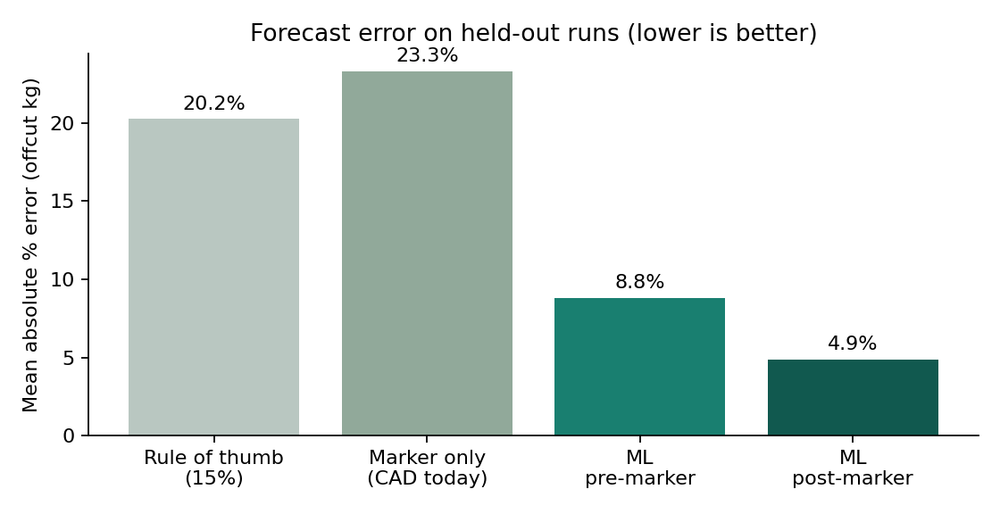
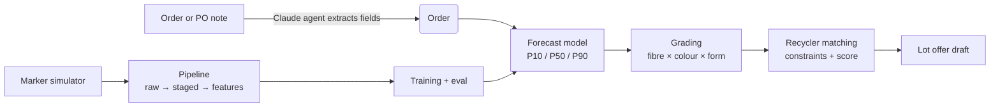

# Scrap Futures: forecasting engine

**Forecast cutting-room textile waste before the fabric is cut, then grade it and match it to recyclers.**

The ML and agent layer of [Scrap Futures](https://scrapfutures.netlify.app/) (this folder was previously the separate `offcut-forecast` repo). Garment factories know roughly how much fabric a cutting plan (a *marker*) wastes. They don't know how much offcut they'll actually weigh at the end of a run, because real cutting rooms lose fabric the marker never shows. This project models that gap, forecasts weighed offcuts with an uncertainty range, and turns the forecast into graded lots a recycler can plan around.



| Method (held-out test set, 1,600 runs) | Mean abs. error, offcut kg | Runs within ±15% | Bias |
|---|---|---|---|
| Industry rule of thumb (flat 15%) | 20.3% | 39.2% | −4.0 pp |
| Marker only (what CAD reports today) | 23.3% | 11.1% | −4.4 pp (always under) |
| **ML, pre-marker** (order data only; runs in the browser) | **8.8%** | **82.4%** | 0.0 pp |
| **ML, post-marker** (adds planned marker efficiency) | **4.9%** | **96.7%** | −0.1 pp |

P10–P90 interval coverage: 76–78% (target 80%). Full numbers: [`models/metrics.json`](models/metrics.json).

> **Honest scope.** Every number above comes from *simulated* production runs (see below). The simulator is built from first principles and calibrated to published ranges, but it isn't factory data. The point of this repo is the method and the system. The first pilot goal is to hit **±15% on real weighed output**.

## What's in here



| Layer | File | What it shows |
|---|---|---|
| Simulation | [`garments.py`](src/offcut/garments.py), [`nesting.py`](src/offcut/nesting.py), [`simulate.py`](src/offcut/simulate.py) | Pattern-piece library with size grading; skyline bottom-left marker nesting that keeps grain direction and searches several layouts; run simulator with selvedge trim, ply-end allowance, roll-end remnants (rolls sold by weight for knits), splicing and reuse, spreading loss by fibre, defects and weighing error |
| Data engineering | [`pipeline.py`](src/offcut/pipeline.py) | Bronze/silver/gold layers, a data contract (types, ranges, vocabularies, mass balance, uniqueness), a quality report, deterministic hash-based train/test split |
| ML | [`train.py`](src/offcut/train.py) | Gradient-boosted quantile regression (P10/P50/P90) compared against two real-world baselines, with calibration checks and per-garment error |
| ML serving | [`export.py`](src/offcut/export.py), [`web/forecast.js`](web/forecast.js) | Trees exported to compact JSON, plus a dependency-free JS evaluator, so the same model runs in Python, in the agent and in the browser. A test proves the JSON reproduces scikit-learn exactly |
| Domain logic | [`grading.py`](src/offcut/grading.py), [`matching.py`](src/offcut/matching.py) | A v0 grade standard (fibre × colour × physical form) and constraint-based recycler matching that reasons over the forecast range, e.g. "P10 clears the minimum lot" |
| AI engineering | [`agent.py`](src/offcut/agent.py) | A Claude agent (Anthropic SDK Tool Runner) that reads a messy PO note, flags its assumptions, calls the deterministic planning tool, and drafts a lot offer. The model never does the arithmetic |
| Tests | [`tests/`](tests/test_offcut.py) | 12 unit tests: nesting geometry, determinism, mass balance, contract violations, export fidelity, service validation, grading and matching constraints |

## Run it

```bash
cd forecasting
pip install -r requirements.txt
make data     # simulate + validate 8,000 runs (~1 min)
make train    # train, evaluate, export browser model, draw figures
make test
make demo     # order -> forecast -> lots -> recycler matches, no API key needed
```

The agent needs the Anthropic SDK and credentials (`ANTHROPIC_API_KEY`, or `ant auth login`):

```bash
pip install -r requirements-agent.txt
make agent
# or: PYTHONPATH=src python -m offcut.agent "PO 88: 9,000m dark denim 12oz, jeans, core sizes, Izmir"
```

It runs on `claude-opus-5-5` with server-side refusal fallback enabled.

## Why the marker isn't enough

The marker reports waste *inside* one lay plan. On the cutting-room floor you also lose:

- selvedge trim on woven fabrics
- a few cm of allowance at both ends of every ply
- roll remnants that don't divide into whole plies (only partly recovered by splicing and small-part recutting)
- spreading loss from splices and slippage, worse on polyester and stretch fabrics
- defects cut out and re-cut

In the simulation the marker alone underestimates weighed offcut by about 4.3 percentage points of fabric, which is roughly a quarter of the real volume. A recycler planning capacity on the marker figure would be consistently short. The model learns those losses from order features (fibre, width, GSM, run length, size spread).

## Calibration

| Quantity | Simulated mean | Published reference |
|---|---|---|
| Marker efficiency: shirts / tees / hoodies | 87% / 87% / 87% | Men's shirts 87.8–89.5% (Đinh et al. 2025); Bangladesh factory marker 86.7% (Nilanto et al. 2024); 80–92% general range (industry guides) |
| Marker efficiency: jeans / dresses | 85% / 80% | Jeans 75–88%; flared dresses lower (curved pieces) |
| Maximum marker efficiency | capped at 93% | Top of reported multi-size ranges |
| Ply-end allowance | 4–6 cm per ply | 4–6 cm per ply (cutting-room practice) |
| Total weighed cutting waste | 19% (70% of runs in 10–20%) | 10–20% (Lectra); 18.3% in a Patagonia Vietnam supply chain (UCSB 2024); 12–15% (BKMEA) |

The data contract rejects runs outside realistic ranges. That's how the 93% cap got added, after the contract caught two impossible markers. A real deployment would replace the simulator with factory marker files (DXF-AAMA) and weighed offcut logs, then retrain. Better simulated labels could come from nesting real pattern geometry ([GarmentCodeData](https://arxiv.org/abs/2405.17609)) with a polygon nester such as [sparrow](https://arxiv.org/abs/2509.13329).

## Related work

- Cutting-room planning tools such as Lectra, Gerber AccuMark and ThreadSol intelloCut already optimise markers and estimate fabric needs and remnants.
- This project's contribution is narrower: predict the *weighed* offcut, by grade, early enough to contract it forward to a recycler.
- Graded lots are meant to align with Textile Exchange's Recycled Material Data Form rather than invent a parallel standard.

## Limitations

- Synthetic data. The model is only as right as the simulator's assumptions until it's trained on real runs.
- Rectangles stand in for true polygon nesting (compensated by a per-garment compactness factor).
- Lot composition by form uses average shares, not per-run attribution.
- Recycler profiles are fictional samples. Real specs, minimum lots and prices come from recyclers.

---

Built by [Cat Liu](https://www.linkedin.com/in/cathyqliu/): 7 years of data engineering (AWS, Databricks, Spark), MSc in AI & Data Analytics.
